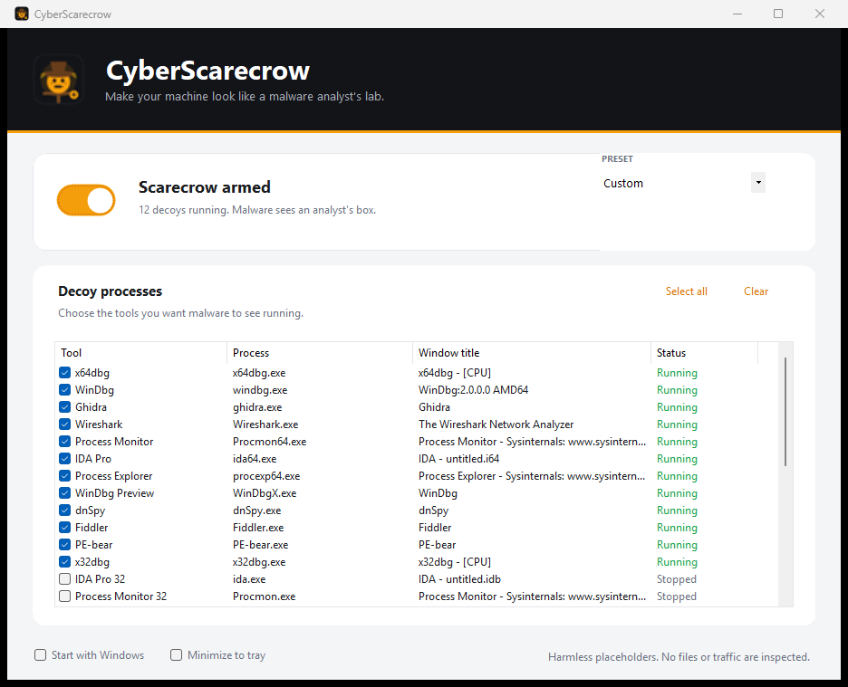

# CyberScarecrow

**A digital scarecrow for your desktop.**

CyberScarecrow makes a Windows machine look like a malware analyst's lab by running harmless decoy processes named after reverse-engineering and forensic tools: x64dbg, WinDbg, Ghidra, IDA, Process Monitor, Wireshark, dnSpy, and more.

Many opportunistic malware families enumerate running processes or window titles and bail out when they see analysis tools. CyberScarecrow gives them something to see.



> It is a deterrent, not a sandbox or antivirus. It does not inspect files, network traffic, or other processes.

## Features

- **Master on/off switch** — arm or disarm every selected decoy with one toggle.
- **Presets and per-tool checkboxes** — Low (5), Medium (12), High (24), or a custom set. Changes apply live while armed.
- **Believable decoys** — each process appears in Task Manager and exposes an off-screen window with a matching title and window class.
- **Never touches real tools** — if a process with the same name is already running, that decoy is skipped and marked **Already running**. Only processes started by CyberScarecrow are ever stopped.
- **Guaranteed cleanup** — decoys are assigned to a Windows Job Object with kill-on-close, and the decoy host watches its manager. If CyberScarecrow exits or crashes, the decoys go with it.
- **Small footprint** — the decoy host is a ~130 KB native Win32 executable, not a .NET runtime per process.
- **Optional tray + autostart** — minimize to the tray, or start hidden and armed at login.

## Quick start

1. Run `dist\CyberScarecrow.exe`.
2. Choose a preset, or tick individual tools.
3. Flip the switch to **arm** the scarecrow.

The framework-dependent build needs the [.NET 8 Desktop Runtime](https://dotnet.microsoft.com/download/dotnet/8.0). For a portable build that bundles the runtime, see below.

## Build

### Prerequisites

- Windows 10 or 11, x64
- [.NET 8 SDK](https://dotnet.microsoft.com/download/dotnet/8.0)
- Visual Studio 2022/2026 Build Tools with the **Desktop development with C++** workload (or Visual Studio Community with C++ tools)
- PowerShell 5.1 or newer

### Commands

```powershell
# Framework-dependent build (small; requires .NET 8 Desktop Runtime)
.\build.ps1

# Self-contained build (larger; no runtime install needed)
.\build.ps1 -SelfContained
```

Output:

```text
dist\
  CyberScarecrow.exe
  CyberScarecrow.Host.exe
```

Keep both files together. `CyberScarecrow.Host.exe` is the native process that gets copied and renamed for each decoy.

## How it works

1. The app copies the native host to `%LOCALAPPDATA%\CyberScarecrow\decoys\<tool>\<process>.exe`.
2. It launches the host with environment variables for the window title, window class, and manager PID.
3. The host creates a visible-but-offscreen top-level window with the requested title/class and pumps messages. The window is in `IsWindowVisible` but not in the taskbar or Alt-Tab.
4. Each decoy is assigned to a Job Object with `JOB_OBJECT_LIMIT_KILL_ON_JOB_CLOSE`. The host also watches the manager PID as a second line of defense.
5. On disarm or exit, only the PIDs started by CyberScarecrow are terminated. Real tools are never touched.

No DLL injection, no hooks, no network activity, no file scanning.

## Decoy catalog

| Preset | Tools |
| --- | --- |
| **Low (5)** | x64dbg, WinDbg, Ghidra, Wireshark, Process Monitor |
| **Medium (12)** | Low + IDA Pro, Process Explorer, WinDbg Preview, dnSpy, Fiddler, PE-bear, x32dbg |
| **High (24)** | Medium + IDA Pro 32, Process Monitor 32, Process Explorer 32, tshark, ILSpy, CFF Explorer, HxD, Scylla, API Monitor, Cheat Engine, Process Hacker, TCPView |
| **Extras** | Autoruns, DebugView, Resource Hacker, Detect It Easy, Binary Ninja, Cutter |

<details>
<summary>Full process list</summary>

| Tool | Process | Window title | Preset |
| --- | --- | --- | --- |
| x64dbg | `x64dbg.exe` | x64dbg - [CPU] | Low |
| WinDbg | `windbg.exe` | WinDbg:2.0.0.0 AMD64 | Low |
| Ghidra | `ghidra.exe` | Ghidra | Low |
| Wireshark | `Wireshark.exe` | The Wireshark Network Analyzer | Low |
| Process Monitor | `Procmon64.exe` | Process Monitor - Sysinternals | Low |
| IDA Pro | `ida64.exe` | IDA - untitled.i64 | Medium |
| Process Explorer | `procexp64.exe` | Process Explorer - Sysinternals | Medium |
| WinDbg Preview | `WinDbgX.exe` | WinDbg | Medium |
| dnSpy | `dnSpy.exe` | dnSpy | Medium |
| Fiddler | `Fiddler.exe` | Fiddler | Medium |
| PE-bear | `PE-bear.exe` | PE-bear | Medium |
| x32dbg | `x32dbg.exe` | x32dbg - [CPU] | Medium |
| IDA Pro 32 | `ida.exe` | IDA - untitled.idb | High |
| Process Monitor 32 | `Procmon.exe` | Process Monitor - Sysinternals | High |
| Process Explorer 32 | `procexp.exe` | Process Explorer - Sysinternals | High |
| tshark | `tshark.exe` | tshark | High |
| ILSpy | `ILSpy.exe` | ILSpy | High |
| CFF Explorer | `CFF Explorer.exe` | CFF Explorer | High |
| HxD | `HxD.exe` | HxD - untitled | High |
| Scylla | `Scylla_x64.exe` | Scylla x64 | High |
| API Monitor | `apimonitor-x64.exe` | API Monitor | High |
| Cheat Engine | `cheatengine-x86_64.exe` | Cheat Engine 7.5 | High |
| Process Hacker | `ProcessHacker.exe` | Process Hacker | High |
| TCPView | `tcpview64.exe` | TCPView - Sysinternals | High |
| Autoruns | `autoruns64.exe` | Autoruns - Sysinternals | Extra |
| DebugView | `Dbgview64.exe` | DebugView - Sysinternals | Extra |
| Resource Hacker | `ResourceHacker.exe` | Resource Hacker | Extra |
| Detect It Easy | `DIE.exe` | Detect It Easy | Extra |
| Binary Ninja | `binaryninja.exe` | Binary Ninja | Extra |
| Cutter | `Cutter.exe` | Cutter | Extra |

</details>

## Limitations

- **Name and title checks only.** CyberScarecrow does not spoof digital signatures, install paths, loaded modules, handles, or VM/sandbox artifacts.
- **Determined malware can spot it.** The host is unsigned, lives under `%LOCALAPPDATA%`, and has an unusual parent process. Sophisticated samples may notice.
- **Anti-cheat and EDR false positives are possible.** Decoys look exactly like the tools they impersonate. Close CyberScarecrow before launching games with anti-cheat, and do not disable security software to make it work.
- **Not a security boundary.** Keep your antivirus, patches, backups, and safe browsing habits. This is a scare tactic, not protection.

## Safety and privacy

- No network access, telemetry, or file scanning.
- No administrator rights required.
- No persistence unless **Start with Windows** is enabled. That writes one value to `HKCU\Software\Microsoft\Windows\CurrentVersion\Run`:
  `"<path>\CyberScarecrow.exe" --minimized --arm`
- Settings live in `%LOCALAPPDATA%\CyberScarecrow\config.json`.
- Decoy files live in `%LOCALAPPDATA%\CyberScarecrow\decoys\`.

## Uninstall

1. Exit CyberScarecrow from the tray menu (or close the window if **Minimize to tray** is off).
2. Delete the app folder.
3. Delete `%LOCALAPPDATA%\CyberScarecrow`.
4. If **Start with Windows** was enabled, remove the Run value:

```powershell
Remove-ItemProperty -Path 'HKCU:\Software\Microsoft\Windows\CurrentVersion\Run' -Name 'CyberScarecrow' -ErrorAction SilentlyContinue
```

## Troubleshooting

| Problem | Fix |
| --- | --- |
| **The decoy host is missing** | Keep `CyberScarecrow.Host.exe` next to `CyberScarecrow.exe`, or run `.\build.ps1`. |
| **Switch flips back off** | No tools are selected, the host is missing, or every selected tool is already running. |
| **A decoy says "Already running"** | A real process with that name is running. CyberScarecrow skips it and will not stop it. |
| **Antivirus/EDR alert** | Unsigned placeholder processes with debugger names can look suspicious. Don't disable protection; only add an exclusion if you understand the tradeoff. |
| **Game anti-cheat complains** | Close CyberScarecrow before gaming. The decoys look like debuggers by design. |
| **Windows SmartScreen warning** | The app is unsigned. Use **More info → Run anyway** if you trust the build, or build it yourself from source. |
| **Start with Windows stopped working** | The app moved. Toggle the setting off and on to rewrite the path. |

## License

[MIT](LICENSE) © 2026 renatti.

CyberScarecrow is not affiliated with, endorsed by, or sponsored by any of the tools it imitates. Product names and trademarks belong to their respective owners; they are used only to describe the decoy process names.

## Development

```text
src/CyberScarecrow.App/   WinForms UI, decoy catalog, process manager
src/CyberScarecrow.Host/  native decoy host (C++ / Win32)
tools/make-icon.ps1       generates the application icon
build.ps1                 builds the host and app into dist/
```

Command-line flags:

| Flag | Meaning |
| --- | --- |
| `--minimized` | Start hidden in the tray. |
| `--arm` | Arm the selected decoys on launch. |
| `--smoke-test` | Headless integration check. Starts three decoys for ~2 seconds and writes a report to `%TEMP%\cyberscarecrow-smoke.txt`. |

```powershell
.\dist\CyberScarecrow.exe --smoke-test
Get-Content "$env:TEMP\cyberscarecrow-smoke.txt"
```

### Design notes

- **Off-screen windows:** window-title checks can find the decoy, but the window sits at `(-32000, -32000)` with `WS_EX_TOOLWINDOW`, so it stays out of the taskbar, Alt-Tab, and your way.
- **Native host:** a single tiny Win32 binary is copied under each decoy name. Twenty decoys cost a few MB each, not twenty .NET runtimes.
- **Job object:** if the manager is killed from Task Manager, Windows closes the job handle and terminates the decoys automatically.
